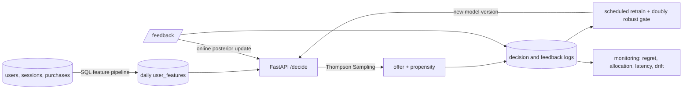

# Contextual Bandit Decision Ops

A real-time offer recommendation system built on a contextual bandit. For every
visit it picks one of five offers with Bayesian Thompson Sampling, keeping a
posterior over each offer's conversion rate and updating it from live feedback.
It uses user history, device, geography, engagement and purchase features
built by SQL feature pipelines.

It serves decisions from FastAPI in Docker or on AWS (ECS Fargate behind an ALB)
against a sub-100 ms target, retrains itself on a schedule, and comes with
offline policy evaluation, backtesting, scenario simulations and monitoring.

> All outcomes come from a synthetic ground truth model, so every offline
> estimate can be checked against the true answer. The numbers below describe
> the simulator, not a live business.

## Headline results

On two held-out weeks, after training on four weeks of logs from the old
rule-based system (`reports/offer_backtest.md`):

| Policy | Conversion | Revenue per user | vs rules |
| --- | ---: | ---: | ---: |
| Rule-based targeting (previous strategy) | 13.50% | 27.67 | baseline |
| Thompson Sampling | **13.97%** | **31.10** | **+12.4%** revenue per user, +0.46 pts conversion |

- **Offline evaluation agrees.** Doubly robust estimates of the frozen policy give
  +0.28 pts conversion and +10.8% revenue per user, and the estimators land
  within a few percent of the simulator's true values. The 95% intervals are wide,
  because a new policy only overlaps with a slice of the old system's logs, and
  the report says so.
- **Policy comparison.** Random, greedy, UCB and Thompson Sampling were compared
  on the same traffic and history. Greedy does well once it has the old system's
  exploration data, but never tries a newly launched offer. Thompson Sampling and
  UCB adapt to cold starts, delayed rewards and shifting conversion rates
  (`reports/offer_scenarios.md`).
- **Latency.** p99 decision latency is in single-digit milliseconds, in process
  and over HTTP, against the 100 ms target (`reports/latency_benchmark.md`).

## How it works



| Piece | Where |
| --- | --- |
| Point-in-time SQL features over SQLite (history, device, geography, engagement, purchases) | `feature_sql.py`, `feature_store.py` |
| Bayesian logistic Thompson Sampling with online Laplace updates, plus Beta-Bernoulli TS | `bayesian_policies.py` |
| Random, rule-based, greedy and UCB baselines | `offer_policies.py` |
| FastAPI service: decide, feedback, posterior, metrics, hot model reload | `offer_service.py`, `offer_api.py` |
| Offline evaluation (IPS, SNIPS, doubly robust), replay, backtesting | `offer_backtest.py` |
| Cold start, delayed reward and drift simulations | `offer_scenarios.py` |
| Automated retraining with a promotion gate and model registry | `retraining.py`, `model_registry.py` |
| Monitoring of regret, allocation, latency and data drift | `offer_monitoring.py` |
| Docker image, plus Terraform for ECR, ECS Fargate, ALB, EFS, EventBridge and CloudWatch | `Dockerfile`, `infra/aws/` |

The full design, including the update equations, is in
[docs/offer_recommendation.md](docs/offer_recommendation.md).

## Quickstart

```bash
python -m venv .venv
source .venv/bin/activate          # Windows: .venv\Scripts\activate
make install
make check                         # pytest and ruff
make offer-smoke                   # exercise the API in process
make offer-demo                    # regenerate every offer report (about 4 minutes)
```

Run the service and try it:

```bash
contextual-bandit-offer-service --port 8000

curl -s -X POST localhost:8000/decide -H 'Content-Type: application/json' \
  -d '{"user_id": "new-user", "device": "mobile", "region": "east"}'
# {"event_id": "offer-...", "offer_id": "free_shipping", "propensity": 0.31, ...}

curl -s -X POST localhost:8000/feedback -H 'Content-Type: application/json' \
  -d '{"event_id": "offer-...", "converted": true}'
# {"status": "accepted", "posterior_updated": true, ...}
```

## Commands

| Command | What it does | Report |
| --- | --- | --- |
| `contextual-bandit-features` | Build the SQLite feature store and daily snapshots | `feature_pipeline_summary.md` |
| `contextual-bandit-offers` | Compare all policies online from a cold start | `offer_policy_comparison.md` |
| `contextual-bandit-backtest` | Train on history, evaluate offline, forward-simulate | `offer_backtest.md` |
| `contextual-bandit-scenarios` | Cold start, delayed rewards, shifting rates | `offer_scenarios.md` |
| `contextual-bandit-offer-service` | Serve the API (`--smoke-test` to check it) | |
| `contextual-bandit-latency` | p50, p95 and p99 against the budget, in process or `--url` | `latency_benchmark.md` |
| `contextual-bandit-retrain` | Ingest logs, refit, gate, promote (`--interval-minutes` to schedule) | `retraining_run.md` |
| `contextual-bandit-monitor` | Regret, allocation, latency and drift from logs (or a drift demo) | `offer_monitoring_report.md` |

Reports are written to `reports/`, and JSON artifacts to `artifacts/`.

## Docker and AWS

```bash
make docker-build
make docker-smoke                  # build, run, health check, decide and feedback

cp infra/aws/terraform.tfvars.example infra/aws/terraform.tfvars   # set VPC and subnets
make deploy-aws                    # push to ECR, terraform apply, health check, latency check
make retrain-aws                   # run the retraining task now
```

The container is configured through environment variables (`MODEL_ARTIFACT`,
`FEATURE_STORE`, `MODEL_POLL_SECONDS`, `EXPLORATION_FLOOR` and others). On AWS,
replicas share an EFS volume for the feature store, logs and model registry.
EventBridge runs retraining nightly, and CloudWatch alarms on p99 latency over
100 ms. See [infra/aws/README.md](infra/aws/README.md).

## Testing

`make check` runs about 200 pytest tests and ruff. The tests cover posterior
updates (exact Beta counts, logit direction, covariance staying the inverse of
precision, online and batch fits recovering a known model), point-in-time
feature correctness, policy decisions and propensities, offline estimators
against simulator truth, the API end to end, retraining, monitoring, and a full
serve, retrain and hot-reload loop.

## Foundations (release 0.1.0)

The project started as a general contextual bandit toolkit, which is still here
and still tested: a three-action simulator, LinUCB and linear Thompson Sampling,
replay, IPS, SNIPS and doubly robust estimators, safety-constrained promotion
gates, a staging decision API and drift checks. `make demo` regenerates those
reports. Start with the [0.1.0 release summary](reports/portfolio/release_0.1.0.md).

| Document | Question it answers |
| --- | --- |
| [Offer recommendation design](docs/offer_recommendation.md) | How the offer system works, end to end |
| [AWS deployment](infra/aws/README.md) | What runs where on AWS, and how to deploy it |
| [Architecture](docs/architecture.md) | How the 0.1.0 toolkit's pieces connect |
| [Evaluation methodology](docs/evaluation_methodology.md) | What the estimators and regret metrics mean |
| [Policy card](docs/policy_card.md) | What the 0.1.0 policy may and may not be used for |
| [Operations](docs/operations.md) | How the local and staging setup is run |

## Limits

- Outcomes are synthetic. The comparisons show relative behavior under a plausible
  world, not real lift, which would need an online experiment.
- SQLite is the feature store and event log. That's fine for a demo and modest
  traffic; at scale it would be a warehouse or Aurora plus a log stream.
- The Terraform passes `terraform validate` but hasn't been applied from this
  repository.

## License

MIT
