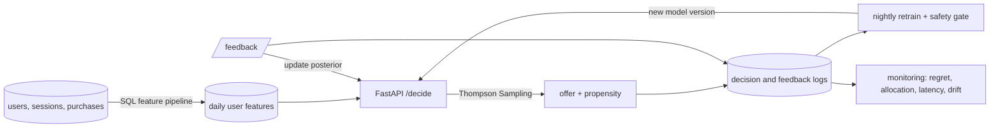

# Real-Time Contextual Bandit Offer Recommendation System


Picks the best offer for every visitor in real time, and gets better with every
conversion it sees.

- **Bayesian Thompson Sampling.** Each offer keeps a posterior over its
  conversion rate, conditioned on user history, device, geography, engagement and
  purchase features. Every piece of feedback updates that posterior straight away.
- **Built to serve.** A FastAPI service on Docker and AWS answers against a
  sub-100 ms target. Features come from SQL pipelines, the model retrains itself
  on a schedule, and pytest covers posterior updates, features and policy
  decisions.
- **Measured before it ships.** Offline policy evaluation and backtesting compare
  random, greedy, UCB and Thompson Sampling on historical data, and simulations
  cover cold start, delayed rewards and shifting conversion rates. Monitoring
  tracks regret, allocation, latency and data drift.

## Results

Trained on four weeks of logs from the old rule-based targeting, then run on two
held-out weeks ([full backtest](reports/offer_backtest.md)):

| Strategy | Conversion | Revenue per user |
| --- | ---: | ---: |
| Rule-based targeting (previous strategy) | 13.50% | 27.67 |
| **Thompson Sampling** | **13.97%** | **31.10 (+12.4%)** |

| What | Result |
| --- | --- |
| Offline estimate (doubly robust) | +0.28 pts conversion, +10.8% revenue per user, within a few percent of the true values |
| Decision latency | p99 of 5.84 ms in process and about 6 ms over HTTP, against a 100 ms target |
| New offer launched mid-run | By the last quarter of the run, Thompson Sampling gives it 34% of traffic (best possible: 38%); greedy and the rules never try it |
| Conversion rates shift mid-run | The rules lose 39,745 in revenue regret afterwards; UCB and Thompson Sampling lose about a quarter of that |

> Outcomes come from a synthetic ground truth model, which is what lets every
> offline estimate be checked against the real answer. These numbers show how the
> policies compare in that world, not lift on a live business. The doubly robust
> intervals are wide, and the [backtest report](reports/offer_backtest.md) shows
> them.

## How it works



1. **Features.** SQL rolls raw sessions, purchases and past offer responses into
   one row per user each morning, counting only what happened before that moment.
2. **Decision.** For each offer, the service samples a conversion rate from its
   posterior, multiplies it by the offer's revenue, and shows the winner. Offers
   the model is unsure about win some of the time, and that is how it explores.
   A 5% uniform floor keeps every offer's logged propensity at 1% or more.
3. **Learning.** Feedback updates the posterior right away. Each night,
   retraining refits the model from the logs and promotes it only if offline
   evaluation shows it is not worse than the rules or the current model.
4. **Watching.** Monitoring compares this week with last week on latency, input
   drift, offer mix, conversion, revenue and regret.

The math, including the update equations, is in
[docs/offer_recommendation.md](docs/offer_recommendation.md).

## Quickstart

```bash
python -m venv .venv
source .venv/bin/activate              # Windows: .venv\Scripts\activate
pip install -e ".[dev]"
pytest -q                              # about 200 tests
contextual-bandit-offer-service --smoke-test
```

Run the service and ask it for an offer:

```bash
contextual-bandit-offer-service --port 8000

curl -s -X POST localhost:8000/decide -H 'Content-Type: application/json' \
  -d '{"user_id": "new-user", "device": "mobile", "region": "east"}'

curl -s -X POST localhost:8000/feedback -H 'Content-Type: application/json' \
  -d '{"event_id": "<event_id from /decide>", "converted": true}'
```

`/decide` returns the offer, its propensity and the posterior's expected
conversion. `/feedback` updates the model and confirms it with
`"posterior_updated": true`. `/metrics` reports p50, p95 and p99 latency.

## Commands and reports

| Command | What it does | Report |
| --- | --- | --- |
| `contextual-bandit-features` | Build the SQLite feature store and daily snapshots | [feature_pipeline_summary.md](reports/feature_pipeline_summary.md) |
| `contextual-bandit-offers` | Compare every policy learning from scratch | [offer_policy_comparison.md](reports/offer_policy_comparison.md) |
| `contextual-bandit-backtest` | Train on history, evaluate offline, run forward | [offer_backtest.md](reports/offer_backtest.md) |
| `contextual-bandit-scenarios` | Cold start, delayed rewards, shifting rates | [offer_scenarios.md](reports/offer_scenarios.md) |
| `contextual-bandit-latency` | Latency against the 100 ms target, in process or `--url` | [latency_benchmark.md](reports/latency_benchmark.md) |
| `contextual-bandit-retrain` | Ingest logs, refit, gate, promote; `--interval-minutes` to schedule | [retraining_run.md](reports/retraining_run.md) |
| `contextual-bandit-monitor` | Regret, allocation, latency and drift from logs, or a drift demo | [offer_monitoring_report.md](reports/offer_monitoring_report.md) |
| `contextual-bandit-offer-service` | Serve the API | |

`make offer-demo` regenerates all of these reports in about four minutes.

## Project layout

```text
src/contextual_bandit_decision_ops/
  feature_sql.py, feature_store.py      SQL feature pipeline over SQLite
  offer_features.py, offers.py          user context, feature encoding, offer catalog
  bayesian_policies.py                  Bayesian Thompson Sampling (logistic and Beta)
  offer_policies.py                     random, rule-based, greedy and UCB baselines
  offer_service.py, offer_api.py        FastAPI decision service
  offer_backtest.py                     IPS, SNIPS, doubly robust, replay, backtesting
  offer_scenarios.py                    cold start, delayed reward and drift simulations
  retraining.py, model_registry.py      scheduled retraining and model versions
  offer_monitoring.py                   regret, allocation, latency and drift checks
infra/aws/                              Terraform: ECR, ECS Fargate, ALB, EFS, EventBridge, CloudWatch
docker/, Dockerfile                     container image and entrypoint
```

## Deploy

```bash
make docker-build && make docker-smoke    # build, run, health check, decide and feedback

cp infra/aws/terraform.tfvars.example infra/aws/terraform.tfvars   # add your VPC and subnets
make deploy-aws                           # push to ECR, apply Terraform, check health and latency
```

On AWS the service runs on ECS Fargate behind a load balancer and scales on CPU.
Replicas share an EFS volume for features, logs and models. EventBridge runs
retraining every night, and CloudWatch alarms when p99 latency goes over 100 ms.
Details are in [infra/aws/README.md](infra/aws/README.md).

## Tests

`pytest -q` runs about 200 tests. They check that posteriors update correctly
(exact Beta counts, logits moving the right way, covariance staying the inverse
of precision, online and batch fits recovering a known model), that features
never use future data, that policies choose and report propensities correctly,
that the offline estimators land near the truth, and that the full loop of
serving, retraining and hot reload works through the API.

## Limits

- Outcomes are simulated. Real lift would need an online A/B test.
- SQLite is fine for a demo and modest traffic. At scale the features would live
  in a warehouse or Aurora, and the logs in a stream such as Kinesis.
- The Terraform passes `terraform validate` but has not been applied from this
  repository.

## Earlier toolkit

The repository grew out of a general contextual bandit toolkit (release 0.1.0):
a three-action simulator, LinUCB and linear Thompson Sampling, off-policy
estimators, promotion gates, a staging API and drift checks. It is still here and
still tested; see the [0.1.0 summary](reports/portfolio/release_0.1.0.md) and
[docs/architecture.md](docs/architecture.md).

## License

MIT
