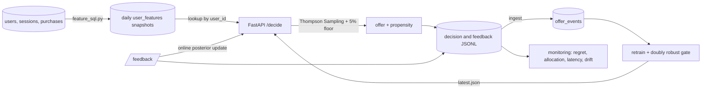

# Offer Recommendation System

A real-time contextual bandit that decides which offer to show each visitor. It
uses Bayesian Thompson Sampling, keeping a posterior over every offer's
conversion rate and updating it from live feedback, and it is built to beat the
old hand-written targeting rules on conversion and revenue per user.

All outcomes in this repository come from a synthetic ground truth model.
That's what lets every offline estimate be checked against the true answer, but
the numbers describe the simulator, not a live business.

## End-to-end flow



## Offers

| Offer | Revenue per conversion |
| --- | ---: |
| `pct10_discount` | 32 |
| `free_shipping` | 38 |
| `bundle_deal` | 55 |
| `premium_trial` | 70 |
| `loyalty_points` | 26 |

The policy maximizes expected revenue, which is conversion probability times
the offer's revenue. Setting `objective="conversion"` optimizes conversion alone.

## Features

Raw activity lives in SQLite (`users`, `sessions`, `purchases`, `offer_events`).
`feature_sql.py` rolls it up into one row per user as of a cutoff time, and only
counts rows strictly before the cutoff. Offer conversions also need their
feedback to have arrived before the cutoff, so a snapshot never sees an outcome
the model couldn't have known yet. Snapshots are materialized every morning into
`user_features`, and the service reads the latest one by `user_id`.

| Group | Fields |
| --- | --- |
| User history | sessions in the last 7 and 30 days, days since last visit, tenure, offers shown and converted in the last 30 days |
| Device | mobile, desktop, tablet |
| Geography | north, south, east, west |
| Engagement | score from 30-day visit frequency and session length |
| Purchases | purchases and spend in the last 90 days, average order value, days since last purchase (empty if never) |

`offer_features.encode_context` turns this into 18 numbers: a bias term, log
scaled counts and money, exponential recency, a never-purchased flag, a smoothed
offer response rate, and one-hot device and region. Most values land in [0, 1],
so one prior works for every weight. A user with no snapshot row yet gets a
cold-start context built from device and region.

## Model

### Contextual Bayesian logistic Thompson Sampling

Each offer `a` has its own logistic conversion model with a Gaussian posterior
over its weights, `w_a ~ N(m_a, S_a)`. The prior is centered on a 5% base rate
(`m_a[bias] = logit(0.05)`), with unit variance on every weight.

**Decision.** For a context `x`, the posterior predictive conversion logit of
offer `a` is normal with mean `m_a . x` and variance `x' S_a x`. Thompson Sampling
draws one logit per offer, maps it through the sigmoid, multiplies by the offer's
revenue, and shows the offer with the highest draw. An offer the model is unsure
about gets a wide draw and wins some of the time, and that is where exploration
comes from. Sampling a scalar per offer costs O(d²) and avoids a Cholesky
factorization per request.

**Online update.** When feedback `y` arrives for offer `a`:

```
p   = sigmoid(m_a . x)
w   = p (1 - p)
S_a = S_a - w (S_a x)(S_a x)' / (1 + w x' S_a x)    # Sherman-Morrison
m_a = m_a + S_a x (y - p)                             # one Newton step
```

This is a Laplace-style assumed-density update. The next request already uses it.

**Batch refit.** Retraining refits from scratch by finding the MAP weights with
Newton's method, plus a backtracking line search, since plain Newton steps
diverged on an offer with high conversion rates. The Laplace covariance at the
optimum is the inverse Hessian.

**Forgetting.** An optional factor pulls the precision back toward the prior
before every update, so old evidence fades when rates drift. The drift sweep
in `reports/offer_scenarios.md` found that mild forgetting (0.9998) helps a
little and stronger forgetting hurts, so it's off by default.

### Beta-Bernoulli Thompson Sampling

A simpler version keeps an exact `Beta(alpha, beta)` posterior on each offer's
conversion rate per segment (device by default). Each conversion adds to `alpha`
and each miss adds to `beta`. It's useful as a sanity check, and it shows how
much the full feature set is worth.

### Propensities and the exploration floor

The service mixes in a 5% uniform exploration floor. The logged propensity of
the shown offer is `floor / K + (1 - floor) * P_TS(offer)`, where `P_TS` is
estimated from 1,000 Monte Carlo posterior draws. Every offer keeps a propensity
of at least 1%, which keeps the logs valid for off-policy evaluation and
retraining.

## Serving

`contextual-bandit-offer-service` runs FastAPI with uvicorn, in Docker locally or
on ECS Fargate behind an ALB.

| Endpoint | Purpose |
| --- | --- |
| `POST /decide` | Choose an offer. Features come from the request, from the feature store by `user_id`, or from a cold-start context |
| `POST /feedback` | Record the outcome and update the posterior right away |
| `POST /posterior` | Posterior mean and 90% interval of every offer's conversion rate for a user |
| `GET /metrics` | Decisions, conversions, revenue, allocation, and decision and request latency p50, p95 and p99 against the 100 ms budget |
| `GET /model`, `POST /model/reload` | Model version and hot reload |
| `GET /offers`, `GET /health` | Catalog and health |

Latency: p99 for `/decide` stays in single-digit milliseconds, more than ten
times under the 100 ms target. The in-process benchmark has measured between 3.6
and 5.8 ms across runs (`reports/latency_benchmark.md`). Against a separate
uvicorn process over HTTP it was 6.1 ms at the client and 2.5 ms at the server.
`contextual-bandit-latency --url` runs the same benchmark against any deployment.

With several replicas, each one writes its own logs, picks up new model versions
by polling `latest.json`, and logs feedback for decisions another replica made,
so retraining still sees every outcome.

## Offline evaluation and backtesting

`contextual-bandit-backtest` replays six weeks of traffic through the old system
(rule-based targeting with 20% uniform exploration) and logs every decision with
its propensity into `offer_events`. Random, greedy, UCB and Thompson Sampling
are trained on the first four weeks and evaluated on the last two in three ways:

1. **Off-policy estimates** of each frozen policy: IPS, SNIPS and doubly robust,
   with paired bootstrap intervals on the lift over the rules. Each estimate is
   checked against the simulator's true value.
2. **Forward simulation**: each warm-started policy runs on the held-out visits
   and keeps learning online.
3. **Replay** (Li et al., with propensity-based acceptance for non-uniform
   logging): every learner starts empty and only learns from events it would have
   chosen.

Held-out results (`reports/offer_backtest.md`):

| Policy | Conversion | Revenue / user | Lift vs rules |
| --- | ---: | ---: | ---: |
| Rule-based | 13.50% | 27.67 | baseline |
| Thompson Sampling (forward, warm start) | 13.97% | 31.10 | +12.4% |
| Thompson Sampling (doubly robust estimate) | 13.70% | 30.60 | +10.8% |

Thompson Sampling beats the rules on both conversion and revenue per user. The
doubly robust intervals are wide (an effective sample size around 870 out of
9,500 events) because a new policy only overlaps with a slice of the old
system's logs. The report shows those intervals rather than hiding them.

`contextual-bandit-offers` covers the cold-start version: every learner starts
with no data on the same four weeks of traffic. Even there, Thompson Sampling
gets 7.7% more revenue per user than the rules and cuts regret by about a third.
It still trails the rules by 1.2 points on overall conversion, because of its
early exploration.

## Scenario simulations

`contextual-bandit-scenarios` (`reports/offer_scenarios.md`):

- **Cold start.** A new offer launches halfway through. Thompson Sampling gives it
  34% of last-quarter traffic, against an oracle share of 38%. Greedy and the rules
  never try it.
- **Delayed rewards.** With conversions arriving after an average of 24 hours,
  Thompson Sampling still finishes ahead of the rules. Going from no delay to 72
  hours costs it about 23% more regret.
- **Shifting conversion rates.** When the rates move halfway through, the rules
  can't react (39,745 regret after the shift), while UCB and Thompson Sampling
  lose about a quarter of that.

## Automated retraining

`contextual-bandit-retrain`, run nightly by EventBridge on AWS or in a loop with
`--interval-minutes`:

1. Ingests every replica's decision and feedback logs into `offer_events`.
   Rerunning is harmless.
2. Takes the last 28 days, fits a candidate on the older 75%, and scores it on the
   newest 25% with doubly robust estimates.
3. Runs a do-no-harm gate: enough data, enough holdout support, and no comparison
   where the 95% bootstrap interval says the candidate is worse than the rules or
   the current model by more than the allowed margin. The current model is only
   judged on outcomes newer than its own training data.
4. Refits a passing candidate on the full window and saves it as a new version in
   the registry (`versions/`, `latest.json`, `registry.jsonl`). The service picks
   it up by polling, or through `--notify-url`.

The gate uses intervals instead of point estimates for a measured reason. In
simulation, point estimates rejected candidates that were truly better in two of
three seeds.

## Monitoring

`contextual-bandit-monitor` compares a reference window of service logs with the
current one and rolls each check up to ok, warn or alert:

| Area | Checks |
| --- | --- |
| Latency | p99 decision latency against the budget, share of decisions inside it |
| Data drift | PSI per numeric feature, total variation for device, region, purchase status and feature source |
| Allocation | total variation of the offer mix, starved offers, allocation over time |
| Outcomes | feedback coverage, conversion change, revenue change |
| Regret | regret under the served model's own posterior, and true regret in simulation |
| Logging | minimum propensity |

The demo serves a normal week, then a week where a mobile campaign brings in new
users and conversion rates shift. It flags the device drift, the offer mix
moving as the bandit adapts, and the revenue drop. It also shows a real limit:
the model's own regret estimate went down while true regret tripled, because a
model can't see the mistakes it doesn't know about. On AWS, CloudWatch alarms
also watch p99 latency at the load balancer, 5xx errors and unhealthy tasks.

## Limits

- Outcomes are synthetic. The comparisons show how the policies behave relative
  to each other under a plausible world, not real lift.
- SQLite is the feature store and the event log. That's fine for a demo and
  modest traffic. A real deployment would use a warehouse or Aurora for features
  and a stream such as Kinesis for logs.
- The AWS Terraform passes `terraform validate`, but it hasn't been applied from
  this repository.
