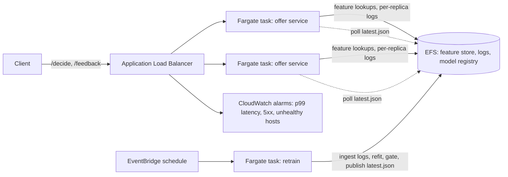

# AWS deployment

Terraform for running the offer service on ECS Fargate, with retraining on a
schedule.



## What gets created

| File | Resources |
| --- | --- |
| `main.tf` | ECR repository with a lifecycle policy, CloudWatch log group |
| `network.tf` | Security groups for the load balancer, the tasks and EFS |
| `storage.tf` | Encrypted EFS volume, a mount target per subnet, and an access point |
| `iam.tf` | Task execution role, and a task role limited to that EFS access point |
| `ecs.tf` | Cluster, service and retrain task definitions, the service, CPU autoscaling |
| `alb.tf` | Load balancer, target group on `/health`, HTTP listener, optional HTTPS |
| `schedule.tf` | EventBridge rule and target for retraining, plus its IAM role |
| `monitoring.tf` | SNS topic, and alarms for p99 latency over 100 ms, 5xx errors and unhealthy tasks |

## How the pieces fit

- Every service task logs decisions and feedback to its own folder under
  `/data/logs`, so replicas never write to the same file.
- Feedback that reaches a different replica than the one that made the decision
  still gets logged, so retraining can match it up.
- The retrain task reads all replica logs into the SQLite feature store, refits
  the posterior, and runs the do-no-harm promotion gate. If the model passes, it
  writes a new `/data/models/latest.json`.
- Each service task checks `latest.json` every `model_poll_seconds` and swaps the
  new model in without a restart.
- SQLite uses `DELETE` journal mode here, because WAL needs shared memory and EFS
  doesn't provide it.
- The first scheduled retrain fills an empty store with synthetic rule-based
  history, so the demo has something to learn from. Set
  `bootstrap_demo_history = false` for real traffic.

## Deploy

You'll need the AWS CLI with credentials, Docker, and Terraform 1.5 or newer.

```bash
cp infra/aws/terraform.tfvars.example infra/aws/terraform.tfvars
# set vpc_id and at least two public subnet_ids
scripts/deploy_aws.sh            # build, push, terraform apply, health check
scripts/retrain_aws.sh           # optional: retrain now instead of waiting for the schedule
```

When the service is healthy, the deploy script runs `contextual-bandit-latency`
against the load balancer, if it's installed, and writes
`reports/latency_benchmark_aws.md`.

To check the deployment by hand:

```bash
url=$(terraform -chdir=infra/aws output -raw service_url)
curl -s "$url/health"
curl -s -X POST "$url/decide" -H 'Content-Type: application/json' \
  -d '{"user_id": "new-user", "device": "mobile", "region": "east"}'
curl -s "$url/metrics"
```

Tear everything down with `terraform -chdir=infra/aws destroy`. The EFS volume
and its data are deleted along with it.

## Limits

- The configuration passes `terraform validate` against AWS provider 5.x. It is
  not applied from CI, because this repository has no AWS account attached.
- SQLite on EFS is fine for a demo and modest traffic. At real scale the feature
  store belongs in Aurora or DynamoDB, and the decision logs in Kinesis Firehose
  writing to S3.
- Tasks run in public subnets with public IPs so they can pull from ECR without
  a NAT gateway. For production, use private subnets with a NAT gateway or VPC
  endpoints.
